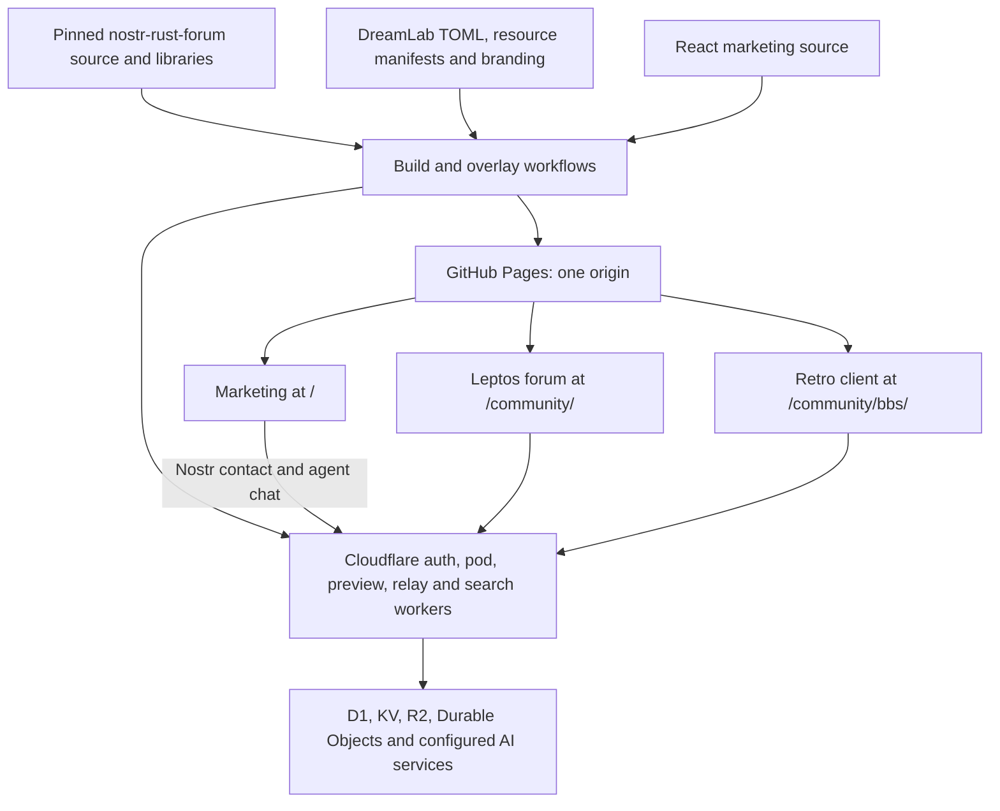
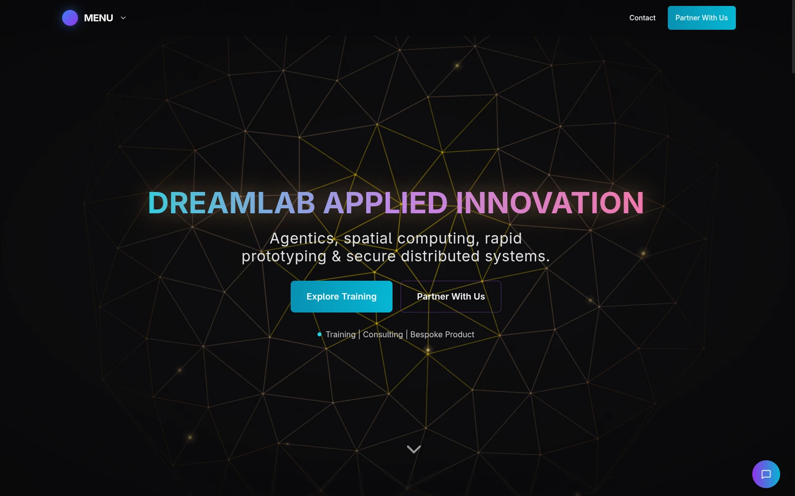
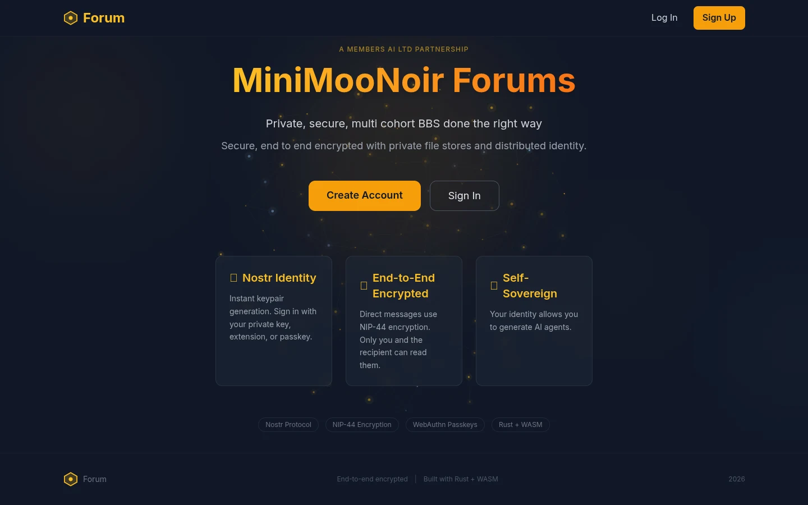
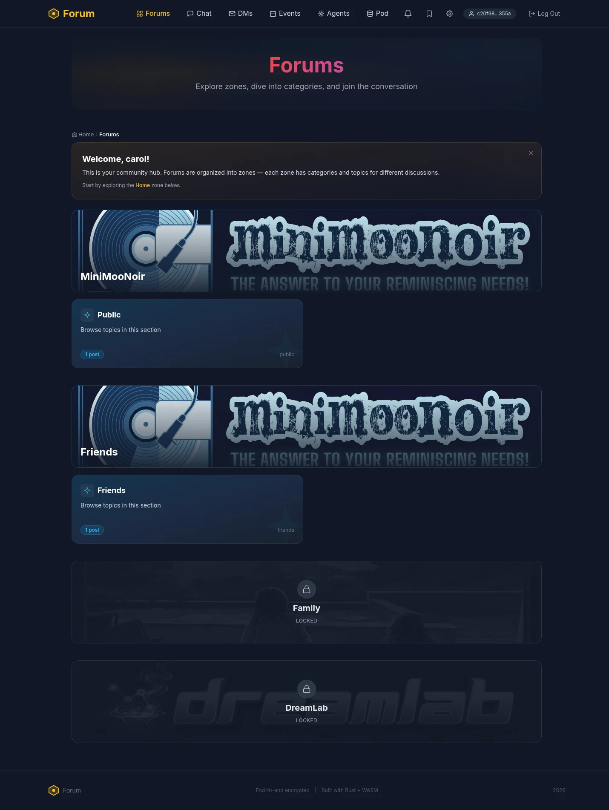
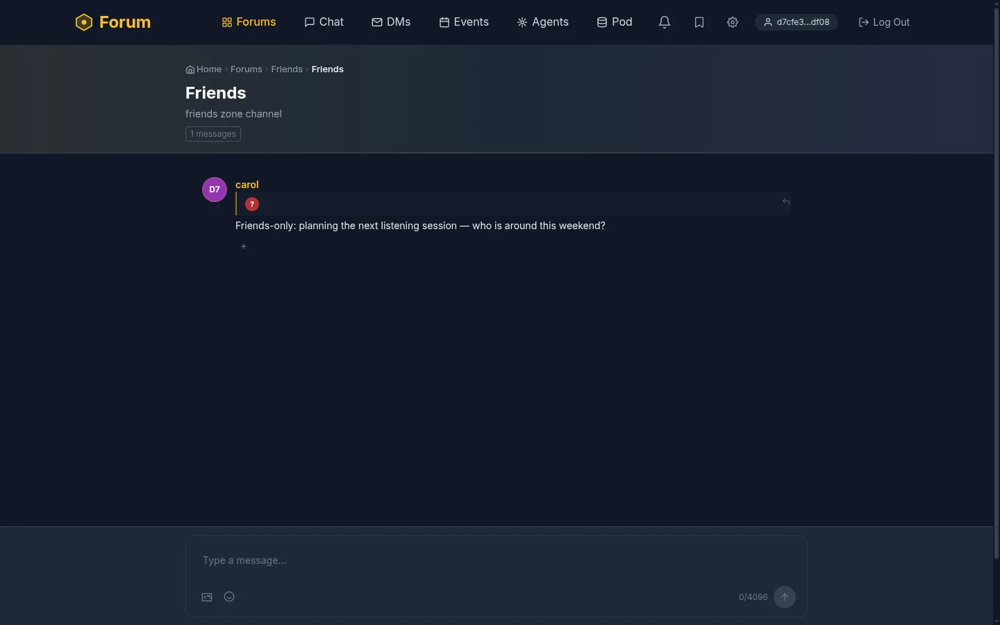
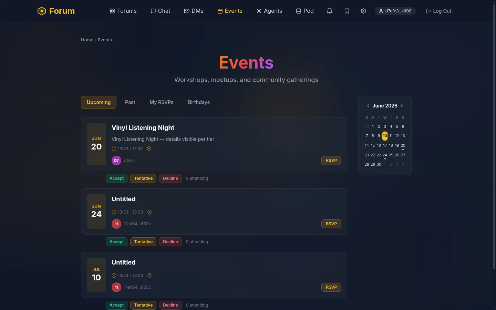

<div align="center">

# DreamLab AI website

### Marketing, community and operator configuration on one public origin

[Website](https://www.dreamlab-ai.com/) · [Community](https://www.dreamlab-ai.com/community/) · [Start](#local-development) · [Architecture](#how-it-is-deployed) · [Status](#working-status) · [Docs](docs/README.md)

</div>

**The company website and branded deployment of the Nostr forum kit.** This repository owns DreamLab's React content, browser-side contact/chat integration and operator overlay. The community clients, relay and service implementations come from [nostr-rust-forum](https://github.com/DreamLab-AI/nostr-rust-forum) at explicitly recorded source and library pins.

Visitors can explore services and workshops, send an enquiry, talk to a configured agent or join a community. Operators configure zones, service identities and Cloudflare resources here. Protocol changes belong upstream in the kit; changing this repository's pin selects which implementation is built.

## Local development

For the marketing site, use Node 20 or later:

```sh
git clone https://github.com/DreamLab-AI/dreamlab-ai-website.git
cd dreamlab-ai-website
npm ci --include=dev
npm run dev
```

Open the Vite URL printed by the command, normally `http://localhost:5173`. This starts the React site; it does not deploy workers or build all community clients.

```sh
npm run build
npm run lint
npm test -- --run
```

The production build also generates content, prerenders routes and checks discovery output through the scripts in [`package.json`](package.json). Community/worker builds require the pinned Rust/WASM toolchain and operator resources described in [deployment](docs/deployment/README.md). Keep credentials in the configured secret stores, not source files.

## How it is deployed



There are **three independently built frontends**, as recorded in [ADR-2003](docs/adr/ADR-2003-three-frontends-one-origin.md). The page origin and the worker runtime are separate hosting surfaces. A successful React build is not a complete community deployment.

| Source | Owns |
|---|---|
| [`src/`](src/) and [`public/`](public/) | Marketing content, routes, brand assets and browser integration |
| [`forum-config/dreamlab.toml`](forum-config/dreamlab.toml) | Operator features, zones, declared agents and ingress recipients |
| [`forum-config/deploy/`](forum-config/deploy/) | Worker bindings, resource IDs, origins and relay configuration |
| [`forum-config/Cargo.toml`](forum-config/Cargo.toml) | Library dependencies selected for the overlay |
| [Kit compatibility record](docs/architecture/kit-compatibility-record.md) | Canonical source SHA, library versions and pin history |
| [Deploy workflow](.github/workflows/deploy.yml) and [worker workflow](.github/workflows/workers-deploy.yml) | Source checkout, builds, environment projection and publication |

The workflows pin kit source `8a5cf81…`, which includes the Jev Worker consumers. Library version pins are independent of client-only source changes; use the compatibility record and manifests rather than an old beta number copied into a README. Pin/mirror checks guard agreement among the declared sites, not the freshness of a live deployment.

## Community and contact flows

The current overlay defines a public **Welcome** zone and locked **Minimoonoir**, **Family** and **DreamLab** zones. Their configured cohorts, encryption and agent-key policy are in the TOML and relay binding; they replace the older public/friends/family/business labels shown in some screenshots.

Access checks belong at the relay and services. A visible locked tile is a presentation of policy, not enforcement by itself. Browser and worker projections must agree; the repository's mirror checks cover those duplicated values.

Contact, signup and agent chat use Nostr gift-wrap messages. Configured recipients and co-recipient copies determine who can read each message. The declared `website-info` identity monitors ingress with no cohorts or administrative privileges; additional recipient copies are additional holders of the message content. See [ADR-2011](docs/adr/ADR-2011-website-information-identity.md) for the identity and verification record, and [`src/lib/nostr.ts`](src/lib/nostr.ts) for browser transport.

<details>
<summary><strong>Recent operator and kit changes</strong></summary>

The history since the September README update includes:

- Nostr-based contact/signup/chat ingress, declared recipients and an inbox-watch path; delivery acknowledgement and a human response remain separate events.
- Kit updates for recipient-scoped gift-wrap reads, logout teardown, relay gates and reviewed security fixes.
- A relay `RELAY_URL` binding that scopes NIP-42 authentication to this deployment, replacing the old claim that the relay uses only a pubkey allowlist.
- Web Push enabled in the operator overlay after the kit's content-free push support; browser permission, subscription and worker configuration remain required.
- Content generation, prerender/discovery checks, route normalisation, SEO monitoring and refreshed company branding.

Consult the current configuration and compatibility history for exact flags and revisions. Source changes and an accepted nightly experiment are not proof that production has deployed them.

</details>

<details>
<summary><strong>Earlier captured screens</strong></summary>

These repository screenshots show earlier branding, zone labels and UI states. They illustrate the surfaces, not today's deployment or an independent proof of encryption, cohort enforcement or passkey behaviour.

| Marketing | Community landing |
|---|---|
|  |  |

| Zone tiles | Friends chat |
|---|---|
|  |  |



</details>

## Where it sits in VisionFlow

[VisionFlow](https://github.com/DreamLab-AI/VisionFlow) owns the cross-estate guide. This repository is the commercial site and operator deployment. [nostr-rust-forum](https://github.com/DreamLab-AI/nostr-rust-forum) owns the community kit; [Agentbox](https://github.com/DreamLab-AI/agentbox) owns configured agent services. Knowledge tooling and [Loom](https://github.com/DreamLab-AI/loom) have separate runtimes and acceptance evidence. Hosting this site does not deploy the whole estate.

## Working status

**Source reviewed 21 October 2026 at `79635b52`.** The repository contains the React site, overlay and publication workflows. Source review confirms the newer pins, relay URL and ingress configuration. No live contact message, production deployment, push subscription or full multi-client acceptance run was performed during this README refresh.

Use [the baseline](docs/BASELINE-architecture.md), [identity/zones](docs/IDENTITY-zones.md), [security overview](docs/security/SECURITY_OVERVIEW.md), [deployment guide](docs/deployment/README.md) and [decision ledger](docs/adr/README.md) for their respective contracts. Older July maturity tables and pin values do not describe current source.

## Jev option (experimental, estate deployment enabled)

Two operator-side uses of TypeSafe System One typed decisions (Choice / Score / Noul). Both are **proposed research candidates with no measured uplift**; confidence floors are unfitted. Neither runs in the browser bundle, so the vendor key never reaches a visitor. The claim check runs after deterministic `postbuild` checks; enquiry tagging runs in the existing inbox watch. Agentbox projects the enable flag and a local endpoint into its service and shell environments at boot. Other deployments retain the library default of off.

Flag: `DREAMLAB_JEV=1` (default off; with it unset no request is built and nothing leaves the process). Endpoint, first match wins, otherwise Jev is unavailable and behaviour is unchanged: `DREAMLAB_JEV_ENDPOINT` (+ `DREAMLAB_JEV_MODEL`, `DREAMLAB_JEV_KEY_ENV` naming the variable that holds a bearer token); the agentbox loopback proxy (`AGENTBOX_SYSTEM_ONE_PROXY=1`, `AGENTBOX_SYSTEM_ONE_ENDPOINT`, `AGENTBOX_SYSTEM_ONE_MODEL`, no auth header); `https://api.typesafe.ai/v1/systemone` with `TYPESAFE_API_KEY`. Hard 4 s deadline, no retries. Fallback reasons (logged, never request content): `flag-off`, `no-endpoint`, `timeout`, `http-<code>`, `malformed`, `low-confidence`.

**DW-02-S1-01, enquiry topic tag (local-only).** The contact form has no server: the browser gift-wraps the enquiry straight to the relay (`src/pages/Contact.tsx`, `src/lib/nostr.ts`). The only operator-side code holding decrypted enquiries is the nightly inbox watch, so that is where this sits. For `enquiry` entries only, `scripts/lib/enquiry-topic.mjs` asks Jev for one topic from the form's own catalogue (`ENQUIRY_TYPES`, kept in step by a test) and whether a needed fact is missing, and the digest line gains ` · ~<topic>[ · needs-info]`. What leaves: the message text (first 1,500 characters) and the type the sender picked; never name or email. Because this is decrypted private mail it is local-only: the public vendor endpoint is never used, an explicit endpoint needs `DREAMLAB_JEV_LOCAL=1`, the proxy needs `AGENTBOX_SYSTEM_ONE_BACKEND_LOCAL=1`. At most 10 enquiries are tagged per run; floor `DREAMLAB_JEV_TOPIC_MIN_CONFIDENCE` (default 0.5). Delivery, the sender's own choice, consent, state persistence and the exit code are untouched, and nothing is sent to a CRM or replied to. The contact notice and privacy page describe local AI topic tagging; the local-only guard remains mandatory.

**DW-06-S1-01, claim evidence checker (public data).** `npm run check:claims [-- --json] [-- file.md ...]` extracts list-item claims from `README.md` and classifies each against the deterministic register `docs/claims-register.json` (`{features:[{id,owner,summary}], claims:[{match,status,evidence}]}`, statuses `supported_here | upstream_only | planned | stale | unsupported`). The source-grounded register is authoritative and ships in this repository; its evidence paths are checked in the test suite. It records source ownership, not deployment proof. Advisories are also dropped when Jev says the feature notes are insufficient to judge. It runs on demand and at the end of `postbuild`, always advisory. Hosted CI without a configured endpoint keeps deterministic classifications and falls back without a model call. With `DREAMLAB_JEV=1` Jev adds *advisory* notes: a suggestion for an unclassified claim, or a disagreement with the register above `DREAMLAB_JEV_CLAIM_MIN_CONFIDENCE` (default 0.6). It never edits copy, never fails the build (always exits 0), and is not deployment evidence. At most 25 claims per run.

Tests: `npx vitest run scripts/__tests__/jev-option.test.mjs` (transport mocked; no network).

## Licence

This repository is **dual-licensed by surface**:

**1. Branded React site (proprietary).** The branded React/WASM application —
everything outside `forum-config/` and the forum surfaces — is proprietary.
Copyright 2024-2026 DreamLab AI Consulting Ltd. All rights reserved. The root
`package.json` is marked `UNLICENSED` and applies to this React site.

**2. Forum surfaces (AGPL-3.0-only).** The forum surfaces — `forum-config/`, the
deployed Cloudflare workers (auth/pod/relay/preview/search), and the Leptos forum
client — are **combined works** of the AGPL-3.0-only
[nostr-rust-forum](https://github.com/DreamLab-AI/nostr-rust-forum) kit, whose
AGPL crates `forum-config` statically links. They are therefore licensed under
**AGPL-3.0-only**. Per **AGPL §13**, users who interact with these surfaces over
a network are entitled to the corresponding source: the canonical source offer is
the upstream kit repository (pinned at the rev recorded in
[`forum-config/Cargo.toml`](forum-config/Cargo.toml)), and the local operator
overlay source lives in [`forum-config/`](forum-config/) (see
[`forum-config/LICENSE`](forum-config/LICENSE)).


Maintained by [DreamLab AI](https://www.dreamlab-ai.com/) and [John O'Hare](https://github.com/jjohare). [MAINTAINERS.md](MAINTAINERS.md) records maintainers and upstream credit.
